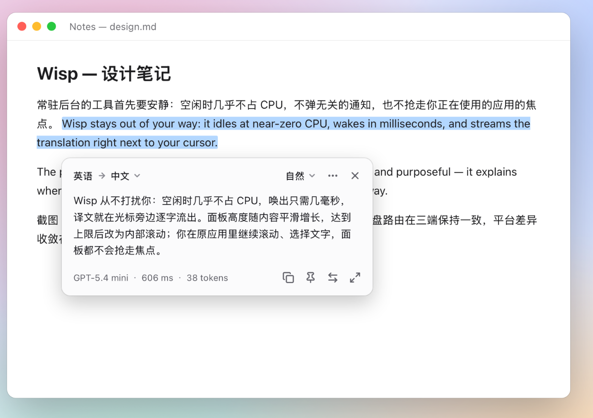
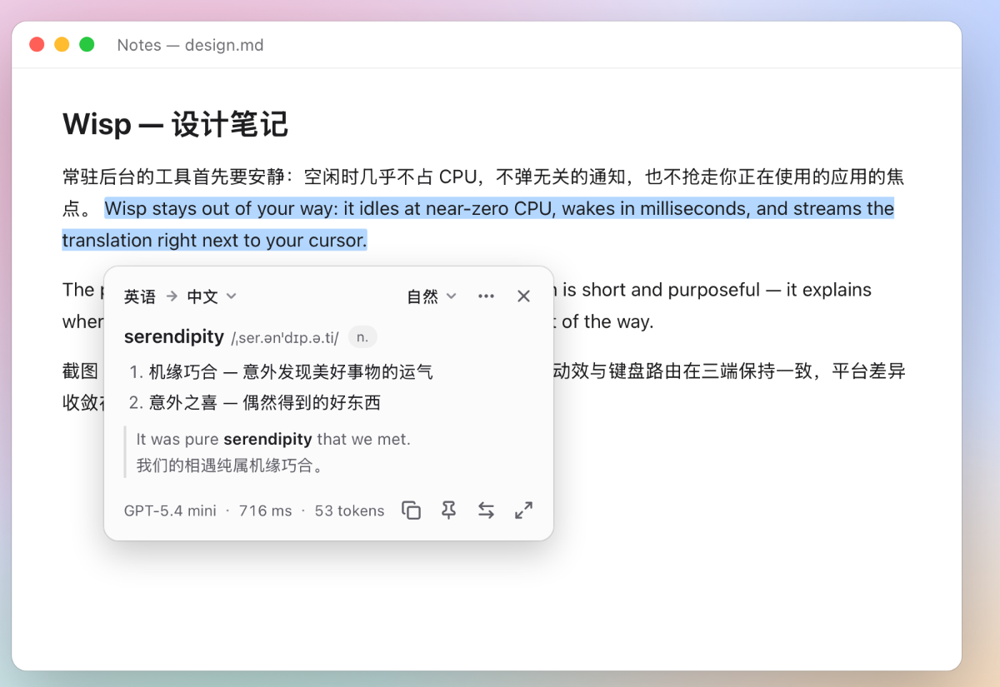
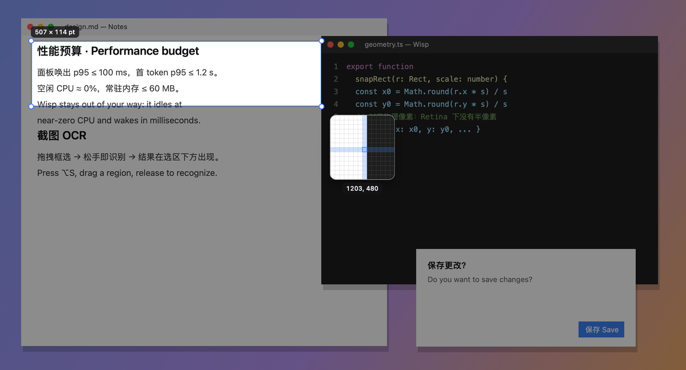
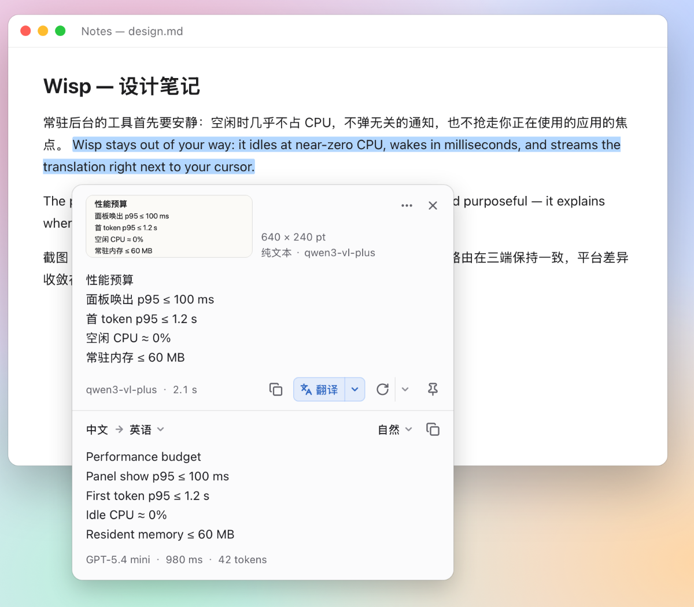
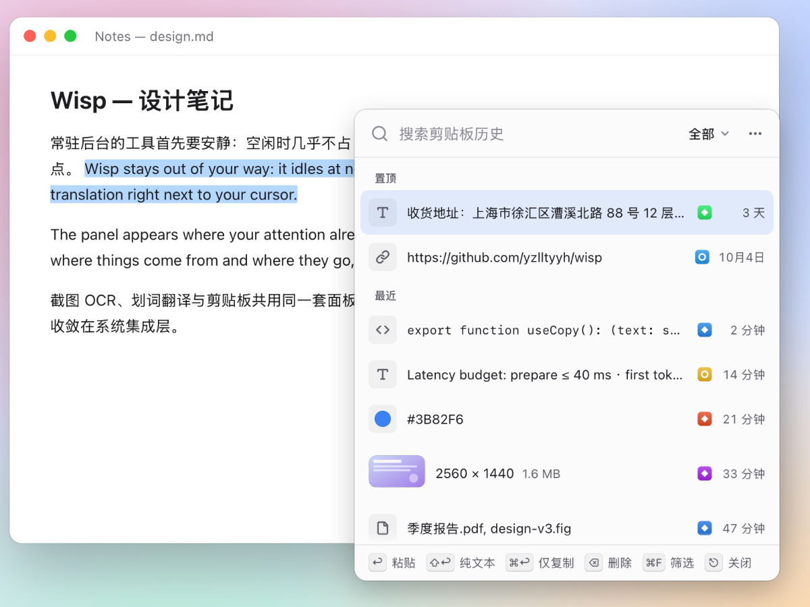
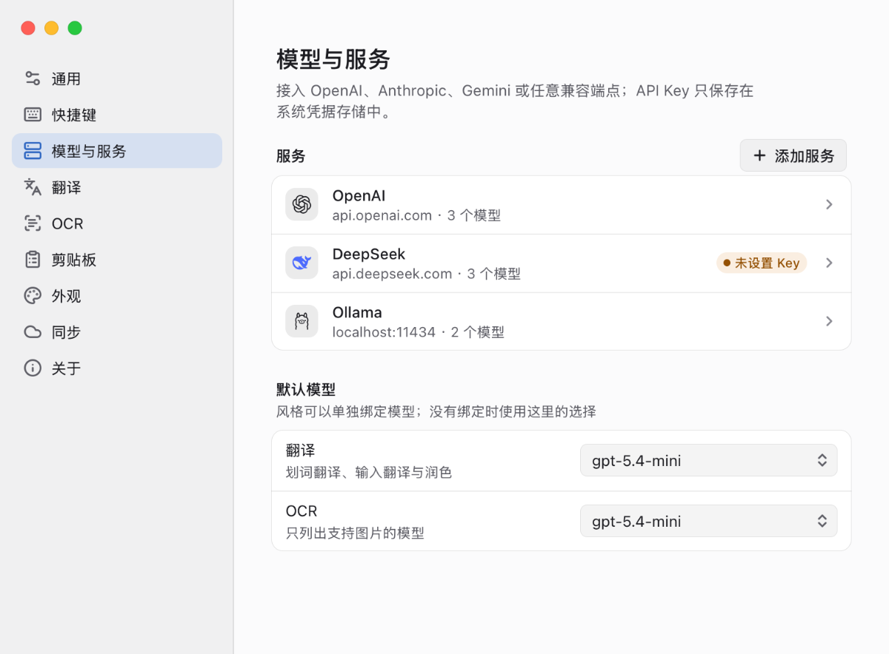

<div align="center">

[简体中文](README.md) · English


# Wisp

**See it. Understand it. Remember it.** A lightweight desktop companion that stays out of sight until you need it: screenshot OCR · selection translation · clipboard history.

macOS (Apple Silicon) · Windows (x64) · Linux (x64)　|　v0.1.1　|　MIT

[Download & install](#install) · [Connect a model](#connect-a-model-provider) · [Shortcuts](#default-shortcuts) · [User guide](docs/user-guide.md) (Chinese) · [Changelog](CHANGELOG.md) (Chinese) · [Feedback](#feedback)

<picture><source media="(prefers-color-scheme: dark)" srcset="docs/images/translate-dark.png"></picture>

<sub>Screenshots show the Chinese UI. The app also ships an English UI, used automatically unless your system language is Simplified Chinese; you can switch it in Settings → General → Interface language.</sub>

</div>

Wisp brings three small things you do all day into one panel that is always a keystroke away: translate the text you've selected, recognize the text in any region of the screen, and get back anything you've copied. It sits quietly in the menu bar or system tray and uses almost no resources. Press a shortcut and the panel appears right where you are looking — without taking focus from the app you're in — and gets out of the way when you're done.

Every AI feature runs on a model you choose: connect OpenAI, Anthropic, Gemini, DeepSeek, Qwen, Kimi, or a local Ollama, or download offline models and keep recognition and translation entirely on your computer. There is no Wisp account, no telemetry, and no relay server, and your API keys are kept in the system credential store, never in configuration files. If you use Wisp on more than one computer, you can sync it through WebDAV storage you own; everything is encrypted on your device before it's uploaded.

## Features

### Selection translation

Select text in any app and press <kbd>⌥ D</kbd> (Windows / Linux: <kbd>Ctrl + Alt + D</kbd>). The translation streams in below the selection, and because the panel never takes focus, you can keep scrolling and selecting in the original app.

- **Automatic direction**: when the text is already in your target language, Wisp translates it into your second language instead (Chinese ⇄ English by default). Flip the direction from the language bar at any time.
- **Six styles**: Natural, Technical, Academic, Casual, Learn (with vocabulary and grammar notes), and Literal, each one keystroke away with <kbd>⌘ 1–9</kbd>. You can also create your own styles, each with its own model and global shortcut.
- **Dictionary-style results**: select a single word or phrase to get its pronunciation, definitions, and example sentences.
- Run **Polish**, **Proofread** (with every change marked), or **Improve translation**; show the source text alongside the translation; pin a result to its own window; apply a glossary; and type or paste text directly when nothing is selected.

<p align="center"><picture><source media="(prefers-color-scheme: dark)" srcset="docs/images/dictionary-dark.png"></picture></p>

### Screenshot OCR

Press <kbd>⌥ S</kbd> (Windows / Linux: <kbd>Ctrl + Alt + S</kbd>). The screen freezes, you drag out a region, and recognition starts the moment you let go.

- A magnifier and a size label help you line up pixels. Hover over a window to highlight it and click to select the whole window; hold Space while dragging to move the selection; press <kbd>⌘ A</kbd> to select the entire screen.
- Three recognition modes: **Plain text** (line by line, keeping line breaks and indentation), **Paragraphs** (joins wrapped lines — good for articles), and **Structured** (headings, lists, and tables as Markdown).
- You can edit the result in place, and it is copied automatically by default; when you're done, press <kbd>⌘ ↩</kbd> to paste it straight back into the app you came from. Click **Translate** to get a translation in the same panel, or press <kbd>⌥ ⇧ S</kbd> to capture and go straight to the translation.
- **Layout**: results come without trailing spaces or extra blank lines. In Plain text and Paragraphs mode you can switch between As recognized, Remove blank lines, and Join lines at any time (<kbd>⌘ L</kbd>), and Plain text mode adds Join lines within paragraphs to rejoin lines wrapped in a PDF; the clipboard follows, so pasting in the app you came from gives you what you see. Pick the default layout in Settings → OCR.
- Recognition can be done by a model that accepts images, by the PaddleOCR cloud service (PP-OCRv6, PP-StructureV3, PaddleOCR-VL), or by [offline models](#offline-models) downloaded to your computer; tables in structured results are shown as real tables.

<p align="center"></p>
<p align="center"><picture><source media="(prefers-color-scheme: dark)" srcset="docs/images/ocr-dark.png"></picture></p>

### Clipboard history

Press <kbd>⌥ V</kbd> (Windows / Linux: <kbd>Ctrl + Alt + V</kbd>) to open your history, start typing to search, and press Return to paste into the app you came from.

- Records text, rich text, images, and files, and recognizes links, colors, and code. Search works even for one or two Chinese characters.
- <kbd>⇧ ↩</kbd> pastes as plain text, <kbd>⌘ ↩</kbd> copies without pasting, <kbd>⌘ 1–9</kbd> pastes an item directly, and Space previews the full text or a larger image.
- **Favorites**: press <kbd>⌘ D</kbd> to keep an item you use often, and give it a name you can search for. Favorites stay at the top of the list and are never cleaned up automatically.
- **Smart detection**: phone numbers, email addresses, links, verification codes, tracking numbers, amounts, and more show up as a row of chips; click one to paste just that part. Verification codes are deleted automatically after 10 minutes. **Paste as** joins lines (or only the lines within each paragraph), removes blank lines, changes case or character width, formats JSON, and removes tracking parameters from links.
- **Multi-select and paste in sequence**: <kbd>⌘</kbd>-click to select several items and press Return to paste them together, or press <kbd>⌘ ↩</kbd> to paste them in sequence — after that, each <kbd>⌘ V</kbd> in any app pastes the next one.
- **Floating clipboard**: <kbd>⌘ P</kbd> turns the clipboard into a small window that stays on top and open; click an item to paste it into the app you're using without taking focus. You can also drag text and links straight into other apps.
- Images can be run through **Recognize text**. Anything that looks like a password, token, or private key is never recorded. Password managers such as 1Password, Bitwarden, and KeePassXC are excluded by default, and Wisp respects apps that mark content as "do not record".

<p align="center"><picture><source media="(prefers-color-scheme: dark)" srcset="docs/images/clipboard-dark.png"></picture></p>

### Multi-device sync

Connect WebDAV storage you own (Nutstore, 123pan, Nextcloud, a Synology NAS, and others) in **Settings → Sync** to keep your settings, model services and API keys, translation styles, glossary, clipboard history (including images), and recognition history in step across your Macs, Windows PCs, and Linux machines. Sync is off by default.

- **End-to-end encrypted**: everything is encrypted on your device with a sync password you choose before it's uploaded, so the server only ever sees ciphertext. There is no Wisp account and no relay server.
- **Automatic and quiet**: your changes are uploaded within seconds, and changes from your other devices are picked up while you use Wisp, with no polling in the background. Conflicts are merged automatically, with no dialogs.
- **Joining never deletes local data**: a new device is merged with what's on the server and keeps the model services, glossary terms, and history only it has. A device that synced before and reconnects picks up anything deleted or cleared on your other devices while it was away.
- **Separate where it matters**: shortcuts sync only between devices on the same operating system, and options such as launch at login and clipboard recording stay on each device.

See [Multi-device sync](docs/user-guide.md#多设备同步) and [Sync and privacy](docs/user-guide.md#同步与隐私) in the user guide (Chinese).

### Offline models

If you'd rather not enter an API key, or don't want your content to leave your computer, download models in **Settings → Offline models**: recognition and translation then run on your device without going online. Nothing is downloaded by default and the installer contains no models; while they aren't in use, they take no memory and no process runs.

| Model | For | Download | Suits |
| --- | --- | --- | --- |
| PP-OCRv6 Tiny | Text recognition: fastest, 49 languages, no Japanese | 6.0 MB | Any device; the CPU is enough |
| PP-OCRv6 Small | Text recognition: balanced speed and accuracy, 50 languages | 30 MB | Any device; the CPU is enough |
| PaddleOCR-VL-1.6 | Text recognition: tables, formulas, and complex layouts | 1.8 GB | Apple silicon with 8 GB of memory or more, or a graphics card with 3 GB of video memory or more |
| Index-Translate 2B | Translation: light and quick, 150 languages | 1.2 GB | 8 GB of memory or more; smooth on the CPU too |
| Index-Translate 9B | Translation: higher quality, 150 languages | 5.4 GB | Apple silicon with 16 GB of memory or more, or a graphics card with 7 GB of video memory or more |

- Settings marks how well each model suits your device based on its memory, chip, and graphics card. The runtimes a model needs (llama.cpp, ONNX Runtime) are downloaded from their official releases along with it; downloads can be paused and resumed, and every file is checked against the SHA-256 recorded in Wisp.
- A model is loaded the first time you use it and its memory is freed after a while without use (5 minutes by default) or when the system runs low on memory; the model files stay. GPU acceleration (Metal on macOS, Vulkan on Windows and Linux) can be turned off to run on the CPU instead.
- Which offline models you use is a per-device choice and is never synced, and Wisp never falls back to a cloud service when an offline model fails. Offline translation models only translate; Polish and Proofread still need a model service.
- The models are released under Apache-2.0; llama.cpp and ONNX Runtime under the MIT License.

See [Offline models](docs/user-guide.md#离线模型) in the user guide (Chinese).

### Details that matter

- **Responsive**: you get feedback the instant you trigger an action. A skeleton animation holds the space until the first words arrive, so you never stare at an empty panel. Motion can be reduced with a single switch.
- **Keyboard first, trackpad friendly**: all five actions have global shortcuts and every action in the panel has a key. Nothing depends on a middle or side mouse button.
- **Appearance**: light or dark, eight accent colors or your own, frosted glass or solid panels, adjustable text size and panel width; Chinese and English UI.
- **Optional extra triggers**: a floating button next to selected text, double-tapping a modifier key, and middle / side mouse buttons. They are off by default, and while they are off Wisp installs no system hooks.
- **Light**: Wisp uses almost no resources while it waits. On an Apple Silicon Mac it idles at about 0.01% CPU, with about 13–15 MiB for the main process and about 50 MiB for the system WebView processes (a bit more for a few dozen seconds after the panel is used; see [Known limitations](#known-limitations)). From shortcut to panel, 95% of repeated invocations take about 30 ms or less, and both the first invocation after launch and the clipboard list with thumbnails stay under 100 ms. The macOS installer is about 7.6 MB.

## Install

Download the package for your platform from the [latest release](https://github.com/yzlltyyh/wisp/releases/latest) (older versions are on the [Releases](https://github.com/yzlltyyh/wisp/releases) page). Only the three platforms below are provided — there are no Intel Mac, Windows ARM64, or universal builds.

| Platform | Package | Requirements |
| --- | --- | --- |
| macOS · Apple Silicon | `Wisp_0.1.1_aarch64.dmg` | macOS 14 Sonoma or later |
| Windows · x64 | `Wisp_0.1.1_x64-setup.exe` | Windows 10 / 11 |
| Linux x64 · Debian / Ubuntu | `Wisp_0.1.1_amd64.deb` | Ubuntu 22.04 / 24.04 (choose "Ubuntu on Xorg"), Debian 12+, or another distribution with an X11 session¹ |
| Linux x64 · Fedora | `Wisp-0.1.1-1.x86_64.rpm` | Fedora; full functionality needs an X11 desktop (Xfce, MATE, Cinnamon, etc.)¹; RHEL-based distributions need EPEL first² |
| Linux x64 · other distributions | `Wisp_0.1.1_amd64.AppImage` | glibc 2.35+ and FUSE 2; full functionality also needs an X11 session¹ |

¹ On Linux, **only X11 sessions are fully supported**. Starting with Ubuntu 25.10 (including 26.04 LTS) and Fedora 43, the default GNOME desktop no longer offers an Xorg session. The packages still install, but Wisp is limited to what works under Wayland (see [Linux](#linux)).

² The rpm uses Fedora package names (`webkit2gtk4.1`, `libayatana-appindicator-gtk3`). On RHEL, AlmaLinux, and Rocky Linux the latter is only available from EPEL, and RHEL-based systems have not been tested. On openSUSE and other distributions with different package names, use the AppImage.

The release notes of every version end with the SHA-256 checksums of all packages so you can verify your download: run `shasum -a 256 <file>` on macOS or Linux, or `Get-FileHash <file>` in PowerShell on Windows.

### macOS

1. Open the dmg and drag **Wisp** into the Applications folder. Don't run it from the dmg or the Downloads folder, or it can't be set to launch at login.
2. **First launch**: Wisp is not notarized by Apple, so macOS blocks it the first time you open it ("Wisp" Not Opened, or Apple could not verify "Wisp"). Click **Done**, open **System Settings → Privacy & Security**, scroll down to the **Security** section, click **Open Anyway**, and confirm.

   Alternatively, remove the download quarantine flag in Terminal; after that, Wisp opens with a normal double-click:

   ```bash
   xattr -dr com.apple.quarantine /Applications/Wisp.app
   ```

3. Wisp lives in the menu bar and normally has no Dock icon; while the Settings window is open, it also appears in the Dock and the ⌘Tab switcher. On first launch it opens an onboarding guide that asks for two permissions:
   - **Accessibility** — to read the selected text and to paste clipboard items back into other apps;
   - **Screen Recording** — for screenshot OCR. Click **Relaunch Wisp** after granting it, or it won't take effect. Starting with macOS 15, the system periodically asks you to confirm Screen Recording access again; simply allow it.

   **Input Monitoring** is needed only if you turn on extra triggers such as double-tapping a modifier key.
4. If Keychain asks whether Wisp may use the API key saved in your keychain, enter your login password and choose **Always Allow**. This usually happens only after updating from an older version.

> [!IMPORTANT]
> Wisp is signed with a stable self-signed certificate (it is not notarized by Apple), so the permissions you grant stay in place across updates. **Updating from 0.1.1 or earlier (which were only ad-hoc signed) needs one last re-grant**: the Wisp menu in the menu bar shows "Re-grant permissions after update" — in **System Settings → Privacy & Security**, open **Accessibility** and **Screen Recording**, remove the old Wisp entry with **−**, then add it again or turn its switch on. If Keychain asks, enter your login password and choose **Always Allow**. Later updates don't need this step.

### Windows

1. Run `Wisp_0.1.1_x64-setup.exe`. The installer is not code-signed, so when SmartScreen shows "Windows protected your PC", click **More info → Run anyway**. If your browser warns that the file is not commonly downloaded, choose to keep it.
2. Wisp installs for the current user and does not need administrator rights. If the WebView2 Runtime is missing (as on some Windows 10 machines), the installer downloads it automatically, so make sure you are online.
3. Wisp lives in the notification area. Its icon may be tucked into the **^** overflow menu; drag it onto the taskbar to keep it visible.
4. To uninstall, find Wisp in **Settings → Apps → Installed apps** on Windows 11, or **Settings → Apps → Apps & features** on Windows 10.

### Linux

```bash
# Debian / Ubuntu
sudo apt install ./Wisp_0.1.1_amd64.deb

# Fedora (enable EPEL first on RHEL / AlmaLinux / Rocky Linux; use the AppImage on openSUSE and similar)
sudo dnf install ./Wisp-0.1.1-1.x86_64.rpm

# AppImage (needs libfuse2 on Ubuntu 22.04, libfuse2t64 on 24.04 and later)
chmod +x Wisp_0.1.1_amd64.AppImage && ./Wisp_0.1.1_amd64.AppImage
```

> [!IMPORTANT]
> **Full functionality requires an X11 session.** Suitable environments:
>
> - Ubuntu 22.04 / 24.04: choose "Ubuntu on Xorg" from the gear menu at the bottom right of the login screen; on Debian 12 / 13, choose "GNOME on Xorg";
> - desktops that still default to X11, such as Xfce, MATE, and Cinnamon — Xubuntu, Ubuntu MATE, Linux Mint, and the matching Fedora editions; KDE editions that still offer a "Plasma (X11)" session (such as Kubuntu 24.04) work as well.
>
> **The default GNOME on Ubuntu 25.10 and later (including 26.04 LTS) and on Fedora 43 and later no longer has an Xorg session**, and Kubuntu 26.04 and Fedora KDE install only the Wayland session by default. In these environments Wisp can only work as described in the Wayland column below: global shortcuts, reading the selection, screenshots, and clipboard history are unavailable, and what remains is mainly typed translation, opened from the tray or with `--trigger`. Wayland global shortcuts and the screenshot portal are on the [roadmap](#roadmap).

- **Tray**: GNOME needs the "AppIndicator and KStatusNotifierItem Support" extension (enabled by default on Ubuntu). Without a tray, Wisp opens the Settings window and shows a notification; every feature is still available through shortcuts.
- **Saving API keys** requires Secret Service (GNOME Keyring or KWallet). Without it, keys are kept only for the current session, and the Settings window tells you so.

| Feature | X11 | Wayland |
| --- | --- | --- |
| Global shortcuts | ✓ | ✗ Bind a system shortcut to `wisp-desktop --trigger <action>` instead |
| Reading the selected text | ✓ (PRIMARY selection, with a simulated copy when needed) | ✗ Opens in input mode; copy the text first, then paste it in |
| Screenshot OCR | ✓ | ✗ Shows "Screenshot failed" with the explanation "Screenshots aren't available in a Wayland session in this version. To take screenshots, switch to an X11 session" (the Wayland screenshot portal is not supported yet) |
| Clipboard history | ✓ | ✗ New copies are not recorded |
| Pasting back into the app | ✓ | Copies only and asks you to press <kbd>Ctrl + V</kbd> |
| Pasting clipboard items in sequence | ✓ | ✗ |
| Extra triggers | ✓ | ✗ |
| Translucent, rounded panels | ✓ | Opaque |

Actions accepted by `--trigger`: `translate_selection`, `translate_input`, `ocr`, `ocr_translate`, and `clipboard`. With the deb or rpm the command is `wisp-desktop`; with the AppImage, use the path to the AppImage file. If Wisp is already running, the command is handed over to the running instance.

## Connect a model provider

Wisp ships without models or API keys: translation and OCR go through services you connect yourself, or through [offline models](#offline-models) you download. You can add a service during onboarding and manage them later in **Settings → Models & services**.

<p align="center"><picture><source media="(prefers-color-scheme: dark)" srcset="docs/images/settings-providers-dark.png"></picture></p>

1. **Add a service** from a template: OpenAI, OpenAI (Responses API), Anthropic, Google Gemini, DeepSeek, OpenRouter, Qwen (Alibaba Cloud Model Studio), Zhipu GLM, Volcengine Ark (Doubao), Moonshot Kimi, SiliconFlow, MiniMax, Groq, Ollama (local), LM Studio (local), **Relay / custom compatible endpoint**, or PaddleOCR, a text recognition service used only for OCR. Templates fill in the protocol, address, and recommended parameters, and you can change all of them.
2. **Enter the Base URL and API key**, then click **Test connection**. Wisp fetches the model list and sends one tiny streaming request to check the whole path. A local Ollama or LM Studio usually needs no key.
3. **Choose default models** for Translation and OCR separately. OCR lists offline models, text recognition services, and models that accept images, and individual styles can use their own model.

Notes on individual services, how image support is detected, advanced options such as turning off "thinking", the PaddleOCR address and access token, and error explanations are in [Model providers](docs/providers.md) (Chinese).

### Four protocols

| Protocol | Best for | Request URL (`{base}` is the normalized Base URL) |
| --- | --- | --- |
| OpenAI Chat Completions | The most compatible option, supported by nearly every service, relay, and local model | `POST {base}/chat/completions` |
| OpenAI Responses | OpenAI's newer official API (Wisp always sends `store: false`, so nothing is stored on the server) | `POST {base}/responses` |
| Anthropic Messages | Claude models | `POST {base}/messages` |
| Google Gemini | Gemini models; all chat models accept images | `POST {base}/models/{model}:streamGenerateContent?alt=sse` |

PaddleOCR is not a chat model: it is added as a text recognition service and used only for OCR. You enter the full service address (the rules below don't apply) and an AI Studio access token; see [Model providers · PaddleOCR](docs/providers.md#paddleocr文字识别服务) (Chinese).

### Base URL rules

Enter the address up to the version segment, without endpoint paths such as `/chat/completions`. The final request URL is shown live below the field as you type.

- If the address has no version segment, Wisp appends one: `/v1` for the OpenAI and Anthropic protocols, `/v1beta` for Gemini;
- an address that already contains a version segment (`/v1`, `/v3`, `/v1beta`, etc.) is used as is;
- if your service's path has no version segment and you don't want one added, end the address with `#` and Wisp will use the path exactly as entered.

| You enter | Final request |
| --- | --- |
| `https://api.openai.com` | `https://api.openai.com/v1/chat/completions` |
| `https://dashscope.aliyuncs.com/compatible-mode/v1` | `…/compatible-mode/v1/chat/completions` |
| `https://ark.cn-beijing.volces.com/api/v3` | `…/api/v3/chat/completions` |
| `https://api.anthropic.com` | `https://api.anthropic.com/v1/messages` |
| `https://generativelanguage.googleapis.com` | `…/v1beta/models/{model}:streamGenerateContent?alt=sse` |
| `http://localhost:11434` (Ollama) | `http://localhost:11434/v1/chat/completions` |
| `https://relay.example.com/openai#` | `https://relay.example.com/openai/chat/completions` |

### Where API keys are stored

Keys are written only to the system credential store. In the macOS Keychain and in Linux Secret Service they are stored under the service name `wisp`, with the service ID as the account; in Windows Credential Manager they appear under **Windows Credentials → Generic Credentials** as `<service ID>.wisp`. Once a key is saved, the UI only says it is saved (for example, "Saved in Keychain") and never shows it again, and keys never appear in configuration files, logs, or diagnostics. The UI process never sees your keys: requests are sent directly by the background process. Deleting a service also deletes its key. PaddleOCR access tokens are stored the same way.

With [multi-device sync](#multi-device-sync) on and **API keys** selected, keys are encrypted on your device and synced to your other devices along with your model services; on arrival they are likewise written only to that device's system credential store. Deleting a service on one device also deletes that service and its key on your other devices.

## Default shortcuts

| Action | macOS | Windows | Linux |
| --- | --- | --- | --- |
| Translate selection | <kbd>⌥ D</kbd> | <kbd>Ctrl + Alt + D</kbd> | <kbd>Ctrl + Alt + D</kbd> |
| Type to translate | <kbd>⌥ ⇧ D</kbd> | <kbd>Ctrl + Alt + Shift + D</kbd> | <kbd>Ctrl + Alt + Shift + D</kbd> |
| Screenshot OCR | <kbd>⌥ S</kbd> | <kbd>Ctrl + Alt + S</kbd> | <kbd>Ctrl + Alt + S</kbd> |
| Screenshot translate | <kbd>⌥ ⇧ S</kbd> | <kbd>Ctrl + Alt + Shift + S</kbd> | <kbd>Ctrl + Alt + Shift + S</kbd> |
| Clipboard | <kbd>⌥ V</kbd> | <kbd>Ctrl + Alt + V</kbd> | <kbd>Ctrl + Alt + V</kbd> |

If a preferred shortcut is already taken by the system or another app, Wisp switches to the alternative below and tells you in its menu bar or tray menu. If neither is available, the shortcut is left unset until you record a new one in **Settings → Shortcuts**.

| Action | macOS alternative | Windows alternative | Linux alternative |
| --- | --- | --- | --- |
| Translate selection | <kbd>⌃ ⌥ D</kbd> | <kbd>Alt + Shift + D</kbd> | <kbd>Super + Alt + D</kbd> |
| Type to translate | <kbd>⌥ A</kbd> | <kbd>Ctrl + Alt + A</kbd> | <kbd>Ctrl + Alt + A</kbd> |
| Screenshot OCR | <kbd>⌃ ⌥ S</kbd> | <kbd>Alt + Shift + S</kbd> | <kbd>Super + Alt + S</kbd> |
| Screenshot translate | <kbd>⌃ ⌥ ⇧ S</kbd> | <kbd>Alt + Shift + T</kbd> | <kbd>Super + Alt + T</kbd> |
| Clipboard | <kbd>⇧ ⌘ V</kbd> | <kbd>Alt + Shift + V</kbd> | <kbd>Super + Alt + V</kbd> |

Common keys inside the panel: <kbd>Esc</kbd> closes it, <kbd>⌘ C</kbd> copies, <kbd>⌘ R</kbd> regenerates, <kbd>⌘ P</kbd> pins a result to its own window (in the clipboard, it opens the floating clipboard), <kbd>⌘ D</kbd> adds a clipboard item to favorites, and <kbd>⌘ ,</kbd> opens Settings (on Windows and Linux, use <kbd>Ctrl</kbd> instead of <kbd>⌘</kbd>). The full list is in the [user guide](docs/user-guide.md#快捷键速查) (Chinese).

## Privacy

- **No data collection**: no telemetry, no Wisp account, no built-in keys, and no relay server in between.
- **Only a few kinds of network requests**: requests to the model services you configured (carrying the text you selected or the region you captured; PaddleOCR is one of them, and screenshots are uploaded to the service address you entered); update checks against GitHub, which you can turn off in **Settings → General → Check for updates**; the sync server you set up and turned on yourself (WebDAV, off by default); and, when you click to download an offline model, the model files from ModelScope or Hugging Face and the runtimes from GitHub. Recognition and translation with offline models never go online. With update checks off and sync not turned on, Wisp sends no requests on its own apart from downloads you start. Clipboard contents are never sent anywhere to build previews.
- **Your data stays on your computer by default**: clipboard history is kept in a local SQLite database (`clipboard.db` and `blobs/` in the data folder). It is not encrypted and relies on your user account and disk encryption for protection. Screenshots are processed in memory and saved locally only if you turn on **Recognition history**. Offline models are kept in `models/` in the data folder. With sync on, whatever you choose to sync is encrypted on your device before it's uploaded to your own WebDAV storage; the server can't see the contents, only the number, sizes, and modification times of the files (see [Sync and privacy](docs/user-guide.md#同步与隐私), in Chinese).
- **Logs contain no content**: logs record only metadata such as timings and status codes — never source text, translations, clipboard contents, screenshots, keys, or PaddleOCR access tokens, never the sync server's address, account, or passwords, and never the output of the offline inference processes. The logs and settings exported with **Settings → About → Diagnostics → Export diagnostics** are redacted in the same way.

## Known limitations

- **Not notarized by Apple; not signed on Windows**: the macOS build is signed with a self-signed certificate, so you have to allow Wisp manually the first time, and updating from 0.1.1 or earlier needs one re-grant of its permissions (see [Install · macOS](#macos)); on Windows, SmartScreen warns you on first run.
- **Windows**: test coverage is not yet as thorough as on macOS, so there may still be undiscovered compatibility issues. If you run into problems, please report them as described under [Feedback](#feedback).
- **Linux**: full functionality requires an X11 session. The default GNOME on Ubuntu 25.10 and later (including 26.04 LTS) and on Fedora 43 and later is Wayland-only, so most features are unavailable there (see [Install · Linux](#linux)). The Linux builds are tested mainly through CI and automated tests, with limited testing on real hardware.
- **Gemini API retirement risk**: the Gemini protocol uses `generateContent` / `streamGenerateContent`. Google is promoting its newer Interactions API; if the older endpoints are retired, the Gemini protocol will stop working. In that case, switch to Gemini's OpenAI-compatible endpoint: choose the OpenAI Chat Completions protocol with the Base URL `https://generativelanguage.googleapis.com/v1beta/openai`.
- **Shortcuts**: once <kbd>⌥</kbd> + a letter is a shortcut, the special character it used to type (such as ∂, ß, or √) can no longer be typed in any app. If Terminal or iTerm2 uses Option as Meta, you lose combinations such as `M-d`; consider the alternative shortcuts. Shortcuts may not fire while Secure Input is active, for example in password fields.
- **Reading the selection**: a few apps don't expose the selected text through the accessibility APIs. Wisp then simulates a copy and restores your clipboard afterwards. On Windows, windows running as administrator can't be read or pasted into automatically.
- **Offline models**: they are tested most thoroughly on macOS (Apple silicon); testing on Windows and Linux is still limited. Computers with only integrated graphics are rated by CPU speed, and that rule still needs checking on real Windows and Linux machines; if you see errors or empty results, turn off **Settings → Offline models → Use GPU acceleration**. The first load of a model can take ten seconds or more (with GPU acceleration, Wisp prepares each model once in the background right after it downloads).
- **Sync**: only WebDAV is supported (HTTP Basic authentication; https is required except for local network addresses). Wisp doesn't sync on a timer in the background, so changes made on another device are picked up only when you use Wisp. File items on the clipboard and images larger than 10 MB are not synced. The sync password can't be changed directly and can't be recovered if forgotten: the only way out is to clear the data on the server and connect again (the data on each device is not affected).
- **Clipboard**: paste in sequence and the floating clipboard rely on global keys and window focus, so they don't work in Linux Wayland sessions (there the floating clipboard can only copy, not paste). Dragging out currently supports text, links, and rich text; images and files can't be dragged into other apps yet. Verification-code detection is deliberately cautious: a message without an explicit word such as "verification code" and without an expiry or "don't share" hint isn't treated as a code.
- **Memory**: for a few dozen seconds after the panel is used, the system WebView holds extra memory (on macOS about 84 MiB, peaking around 90 MiB, until the panel is recycled about 45 seconds after it hides). After recycling it uses about 53–54 MiB (about 49 MiB if the panel was never opened). The main process uses about 13 MiB if the panel was never opened and about 15 MiB afterwards. WebView2 on Windows usually uses more memory than WebKit on macOS.

## Non-goals

Wisp does three things — screenshot OCR, selection translation, and clipboard history — and aims to do them lightly and quickly. The following are deliberately out of scope, and the UI has no entry points for them:

- an app launcher or file search (Spotlight and Raycast already do this well);
- a plugin system or scripting;
- a general-purpose AI chat window (multi-turn conversations);
- Wisp accounts or relay servers — sync goes only through WebDAV storage you own, and your data is encrypted on your device before it's uploaded;
- built-in keys or a relay service — you always use the model services you connect yourself, or offline models you choose to download;
- models bundled in the installer or downloaded automatically — offline models are saved to your computer only after you click to download them;
- voice input and text-to-speech;
- mobile apps.

## Roadmap

Planned directions (not implemented yet, with no entry points in the UI):

- better compatibility on Windows;
- more service templates; better graphics card detection and compatibility for offline models on real Windows and Linux machines;
- more thorough Linux testing, plus global shortcuts and screenshots on Wayland through the GlobalShortcuts and Screenshot portals;
- macOS Developer ID signing and notarization, Windows code signing; distribution through Homebrew Cask, winget, and the AUR;
- clipboard database encryption, searching clipboard images by the text they contain, and dragging clipboard images and files straight into other apps.

Reading translations aloud (text-to-speech) is one of the non-goals above. Whether it is ever added as a small feature will be evaluated separately.

## Development

Tech stack: Tauri 2 (Rust) + React 19 + Motion + Tailwind CSS 4. You need Rust 1.96.1 (pinned by `rust-toolchain.toml`), Node ≥ 24.15 (or 22.x from 22.22.2), and pnpm ≥ 12.3.4 (picked up automatically after `corepack enable`); on Linux you also need WebKitGTK 4.1 and a few other system libraries (`bash scripts/ci/linux-deps.sh`).

```bash
pnpm install --frozen-lockfile
pnpm dev                          # run in development (WISP_FAKE_LLM=1 uses a built-in fake model, no key needed)
pnpm -C apps/desktop dev:mock     # front end with a browser mock only, for UI work
pnpm build:debug                  # build a debug installer (no updater private key needed)
cargo test --workspace && pnpm test
```

On macOS, privacy permissions and keychain access are tied to the code signature, and the default ad-hoc signature changes on every rebuild, which invalidates earlier grants. Run `scripts/dev-sign-macos.sh --init` once to create a development certificate, then use `scripts/dev-sign-macos.sh --dev` instead of `pnpm dev`; permissions then survive rebuilds (see [macOS development signing](docs/development.md#macos-开发签名) in the development guide).

- [Development guide](docs/development.md): environment, build and test commands, debugging, CI, and the release process;
- [Architecture](docs/architecture.md): process and module structure, IPC, windows, the platform layer, multi-device sync, data and configuration;
- [Contributing](CONTRIBUTING.md): issues and pull requests, code style, and commit conventions.

These documents are in Simplified Chinese, and so are the code comments (identifiers are in English); issues, pull requests, and commit messages are welcome in English or Chinese. [CONTRIBUTING.en.md](CONTRIBUTING.en.md) summarizes the contribution rules in English. The full index of documents is in [docs/](docs/README.md).

## Project status

The current version is **v0.1.1** (2026-10-14, [release page](https://github.com/yzlltyyh/wisp/releases/tag/v0.1.1)): every floating panel can now be dragged, and screenshot selection under fractional display scaling on Windows and the blank Dock icon shown while Settings is open on macOS are fixed.

All three core features are in place, along with settings, onboarding, automatic updates, and diagnostics export (the first version, 0.1.0, was released on 2026-10-13 and has been superseded by 0.1.1). macOS is the most thoroughly tested platform; test coverage on Windows and Linux is still being expanded. See [CHANGELOG.md](CHANGELOG.md) (Chinese) for the full list of changes.

## Feedback

Please report problems and suggestions in [GitHub Issues](https://github.com/yzlltyyh/wisp/issues/new/choose) (choose the bug report or feature request template), and include:

- your Wisp version (**Settings → About**) and operating system version (for example, macOS 15.5, Windows 11 24H2, or Ubuntu 24.04 on Xorg);
- the steps you took, what you expected, and what actually happened — screenshots or a screen recording help a lot;
- **a diagnostics bundle**: **Settings → About → Diagnostics → Export diagnostics** saves a zip file you can attach. It contains redacted logs and settings, your translation styles, version and system information, and selection statistics (the [user guide](docs/user-guide.md#诊断导出与反馈) lists every file, in Chinese), but no API keys, no sync server address, account, or passwords, and none of your source text, translations, or clipboard contents. You can unzip it and check before sending. To capture more detail, temporarily set **Settings → General → Advanced → Log level** to **Debug** and reproduce the problem once more.

**Never post your API key in an issue, screenshot, or log** — the same goes for the app password and sync password you use for sync. Please blur keys, personal information, and clipboard contents in screenshots before uploading.

**Please don't report security vulnerabilities in public issues.** See [SECURITY.md](SECURITY.md#english) for how to report them privately. To contribute, see [CONTRIBUTING.md](CONTRIBUTING.md) (Chinese).

## License

[MIT](LICENSE) © 2026 yzlltyyh

A wisp (/wɪsp/) is a thin curl of smoke, a faint glimmer of light — weightless, quick, and barely noticeable, which is exactly what this app sets out to be.
